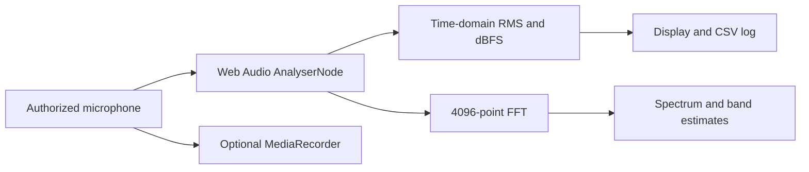

# DBMètre Pro — Studio Niko Design

**Browser audio measurement · Web Audio FFT · Experimental digital level meter**

[Source](index.html) · [Licence](LICENSE.md) · [English overview](#english-overview)

## Architecture



| Fonction | Implémentation constatée |
| --- | --- |
| `calculateDbFS` | Échantillons temporels 8 bits centrés, RMS puis 20 log10(RMS), borné de −100 à 0 dBFS |
| `averageBandDb` | Conversion des bins en puissance linéaire, moyenne puis 10 log10 |
| `dominantFrequency` | Sélection du bin spectral maximal dans la bande analysée, sans interpolation |
| `renderLoop` | Niveau affiché avec offset, moyenne arithmétique des niveaux en dB et maximum des fenêtres RMS |
| `startRecording` | MediaRecorder, format selon compatibilité navigateur |

La résolution fréquentielle nominale est fs/4096, soit environ 11,72 Hz si fs vaut 48 kHz. Le maximum affiché n'est pas un vrai pic d'échantillon ; la moyenne des dB n'est pas un Leq énergétique. Les bins quantifiés et bornés, le bruit de fond et la réponse du microphone limitent les résultats. La désactivation demandée du gain automatique, de l'annulation d'écho et de la réduction de bruit ne garantit pas l'absence de traitement matériel.

## Qualification proposée — signal synthétique uniquement

| Entrée de référence | Résultat attendu du calcul local |
| --- | --- |
| Tous les octets temporels à 128 | −100 dBFS (plancher numérique) |
| Tous les octets à 192 | −6,02 dBFS (RMS 0,5 ; test numérique, pas une mesure acoustique) |
| Fréquence alignée sur le bin 100, fs = 48 kHz | 1171,875 Hz pour ce bin |
| Niveau avec offset | Addition de l'offset au dBFS, sans preuve d'étalonnage SPL |

Ces valeurs sont des oracles mathématiques proposés, non des résultats d'exécution. Vérifier séparément le microphone, les permissions, les enregistrements, le CSV, le comportement sur silence et les changements de fréquence d'échantillonnage. Ne pas utiliser pour une décision de sécurité auditive, une expertise réglementaire ou une mesure certifiée.

## Documentation d'utilisation

Application web autonome de mesure sonore.

## Fonctions
- autorisation microphone explicite avec état accordé/refusé
- fallback getUserMedia pour anciens navigateurs compatibles
- analyse spectrale FFT temps réel de 20 Hz à 20 kHz
- fréquence dominante
- énergie moyenne par bandes : graves / médiums / aigus
- mesure micro en temps réel
- affichage dBFS
- offset de calibration pour approximation dB SPL
- moyenne et pic
- graphe temps réel
- journal horodaté
- export CSV
- enregistrement audio via MediaRecorder
- téléchargement de l'enregistrement

## Lancer
Le micro est généralement autorisé uniquement depuis :
- `https://...`
- ou `http://localhost`

Exemple :
```bash
python3 -m http.server 8080
```
Puis ouvrir :
`http://localhost:8080`

## Calibration
Les navigateurs ne fournissent pas une valeur SPL absolue fiable.
Pour calibrer :
1. placez un sonomètre de référence près du téléphone/ordinateur ;
2. diffusez un bruit stable ;
3. comparez la valeur de référence à la valeur dBFS affichée ;
4. entrez la différence dans "Offset de calibration SPL".


## Précision des mesures et limites

**Thème : son · outils de mesure.** Le niveau numérique **dBFS** est une mesure relative à la pleine échelle du signal acquis ; ce n'est pas une mesure absolue de pression acoustique en **dB SPL**. L'offset permet une estimation uniquement après comparaison à un sonomètre de référence dans des conditions contrôlées, mais ne remplace pas la réponse fréquentielle, l'étalonnage et les tolérances d'un appareil de mesure certifié.

L'application dépend des caractéristiques du microphone, des traitements du système, du navigateur et des autorisations de capture. Ne pas l'utiliser pour une expertise réglementaire du bruit, une évaluation d'exposition professionnelle ou une décision de sécurité auditive.

**Confidentialité :** l'accès au microphone exige l'autorisation de l'utilisateur ; examiner le code et les destinations réseau avant utilisation avec un son confidentiel. Les enregistrements ne doivent pas être publiés dans les issues GitHub.

**Statut :** instrument de visualisation / exploration non certifié ; tests de précision non attestés.

[Catalogue Studio Niko Design](https://github.com/Nikoju1977).


## Précision, permissions et confidentialité

- L'interface affiche le **dBFS**, c'est-à-dire un niveau numérique relatif à la pleine échelle. Ce n'est pas une mesure absolue en **dB SPL**.
- L'offset de calibration fourni par l'application est **une approximation** dépendant du microphone, de son traitement automatique, du navigateur, de la fréquence et de l'environnement. Il ne transforme pas le téléphone en sonomètre réglementaire.
- Une autorisation explicite du microphone est nécessaire. Vérifier les paramètres de confidentialité du navigateur ; une éventuelle capture audio ne doit être faite qu'avec l'accord des personnes concernées.
- Pour des mesures de sécurité au travail ou de conformité acoustique, employer un instrument approprié et étalonné.

**Statut :** outil expérimental de visualisation sonore, sans qualification métrologique revendiquée.

[Catalogue des outils Studio Niko Design](https://github.com/Nikoju1977).


## English overview

DBMètre Pro computes digital RMS levels and a 4096-point FFT using browser Web Audio. The displayed peak is a maximum of RMS windows, not sample peak; the arithmetic dB average is not Leq. Calibration offset does not establish absolute SPL accuracy. The proposed synthetic numerical checks are not executed tests. No microphone, device or deployment validation was performed.

[Notice de droits](LICENSE.md) : droits réservés pour les contributions originales concernées. Aucun changement de licence.
